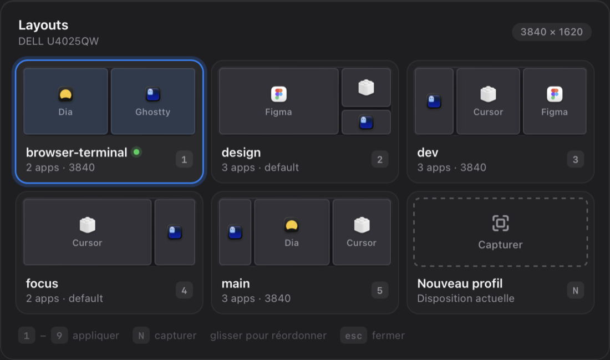
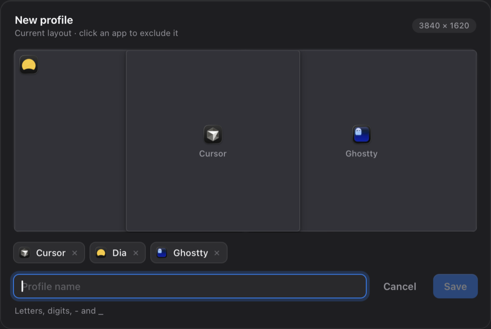

# Windr — tes dispositions de fenêtres en un clic

Windr ajoute une icône dans la barre de menus macOS. Elle ouvre un panneau avec tes **profils de disposition** (où va Cursor, où va le terminal, où va Figma…). Un clic sur un profil, et toutes les fenêtres se placent.



- **Appliquer** un profil : un clic, ou les touches `1` à `9`
- **Capturer** la disposition actuelle de tes fenêtres pour créer un nouveau profil
- **Modifier** un profil : retirer une app, le renommer
- **Réordonner** les profils par glisser-déposer
- **Variantes par écran** : un même profil peut avoir une disposition pour ton écran externe et une autre pour le MacBook
- **Rangés par écran** : un onglet par écran, chaque moniteur a sa propre liste de profils

Windr est un plugin (« Spoon ») pour [Hammerspoon](https://www.hammerspoon.org), un outil d'automatisation macOS gratuit et open source.

🇬🇧 [English version](README.md) · 📋 [Historique des versions](CHANGELOG.md) (en anglais)

> L'interface suit la langue de macOS (français ou anglais). L'option `language` permet d'en forcer une.

---

## Installation (5 minutes)

### 1. Installer Hammerspoon

```sh
brew install --cask hammerspoon
```

Sans Homebrew, tu peux aussi le télécharger sur [hammerspoon.org](https://www.hammerspoon.org).

Lance Hammerspoon, puis :

- **Autorise l'accessibilité** : `Réglages Système → Confidentialité et sécurité → Accessibilité` → active **Hammerspoon**. Sans cette autorisation, les fenêtres ne bougent pas.
- **Lancement au démarrage** : clique sur l'icône Hammerspoon (le marteau) dans la barre de menus, puis `Preferences…` → coche **Launch Hammerspoon at login**.

### 2. Installer Windr

[**Télécharge Windr.zip**](https://github.com/jcsuzanne/windr/releases/latest/download/Windr.zip), décompresse-le, puis **double-clique sur `Windr.spoon`**. Hammerspoon l'installe tout seul dans `~/.hammerspoon/Spoons/`.

Si le double-clic ne fait rien, copie-le à la main :

```sh
mkdir -p ~/.hammerspoon/Spoons && cp -R Windr.spoon ~/.hammerspoon/Spoons/
```

### 3. Activer Windr

Ouvre le fichier de config de Hammerspoon. Tu peux passer par l'icône marteau → `Open Config`, ou ouvrir directement `~/.hammerspoon/init.lua`. Ajoute :

```lua
hs.loadSpoon("Windr")
spoon.Windr:start()
```

Enregistre, puis icône marteau → **Reload Config**. Une nouvelle icône ▥ apparaît dans la barre de menus : c'est Windr.

---

## Mise à jour

Tes profils, leur ordre et tes options sont **conservés** : ils sont dans `~/.hammerspoon/windr_layouts.json` et dans ton `init.lua`, en dehors du dossier du Spoon. Une mise à jour remplace seulement `~/.hammerspoon/Spoons/Windr.spoon`.

**Option 1 : une commande dans le terminal (recommandé)**

```sh
cd "${TMPDIR:-/tmp}" && curl -fsSL -o Windr.zip https://github.com/jcsuzanne/windr/releases/latest/download/Windr.zip \
  && rm -rf windr-update && unzip -q Windr.zip -d windr-update \
  && rm -rf ~/.hammerspoon/Spoons/Windr.spoon && cp -R windr-update/Windr.spoon ~/.hammerspoon/Spoons/
```

Puis icône marteau → **Reload Config**. Si tu as installé la commande `hs` (voir plus bas), `hs -c 'hs.reload()'` fait la même chose.

**Option 2 : à la main**

1. [Télécharge Windr.zip](https://github.com/jcsuzanne/windr/releases/latest/download/Windr.zip) et décompresse-le.
2. Supprime l'ancien dossier `~/.hammerspoon/Spoons/Windr.spoon`. Dans le Finder : `⌘⇧G`, puis colle `~/.hammerspoon/Spoons`.
3. Double-clique sur le nouveau `Windr.spoon`, ou copie-le dans ce dossier.
4. Icône marteau → **Reload Config**.

**Option 3 : avec git**, si tu préfères suivre le repo

```sh
git clone https://github.com/jcsuzanne/windr.git ~/Code/windr
rm -rf ~/.hammerspoon/Spoons/Windr.spoon
ln -s ~/Code/windr/Windr.spoon ~/.hammerspoon/Spoons/Windr.spoon
```

Ensuite, mettre à jour se résume à `git -C ~/Code/windr pull` puis **Reload Config**.

**Quelle version j'ai ?** Survole l'icône Windr dans la barre de menus, ou icône marteau → `Console`, tape `spoon.Windr.version` puis Entrée. Les nouveautés de chaque version sont dans le [changelog](CHANGELOG.md).

---

## Premiers pas : créer ton premier profil

1. Place tes fenêtres comme tu les aimes (par exemple l'éditeur à gauche, le navigateur à droite).
2. Clique sur l'icône Windr, ou appuie sur `⌘⌥⌃Espace`.
3. Clique sur **Capturer**, ou appuie sur `N`.
4. Un aperçu de ta disposition s'affiche. **Clique sur une app pour l'exclure** si elle ne doit pas faire partie du profil.
5. Donne un nom (`dev`, `design`, `call`…) puis **Entrée**.

C'est tout. La prochaine fois, ouvre le panneau et clique sur `dev` : tout se remet en place.



> Finder et Réglages Système ne sont jamais capturés, car ce sont souvent des fenêtres ouvertes par hasard.

---

## Utilisation

| Action | Comment |
| --- | --- |
| Ouvrir / fermer le panneau | Icône dans la barre de menus, ou `⌘⌥⌃Espace` |
| Appliquer un profil | Clic sur la carte, `1`–`9`, ou flèches + `Entrée` |
| Nouveau profil | Carte **Capturer** ou `N` |
| Réordonner | Glisser-déposer une carte (les numéros suivent) |
| Changer d'écran | Clic sur un onglet au-dessus des cartes, ou `Tab` / `⇧Tab` |
| Aide : ce que fait chaque bouton | Bouton **?** en haut à droite, ou `?` |
| Fermer | `Échap` ou clic ailleurs |

En survolant une carte, ses boutons apparaissent en haut à droite :

- ✏️ **Modifier** : retirer ou remettre des apps, renommer le profil
- ⧉ **Remplacer** : remplace le profil par la disposition actuelle des fenêtres
- 🖥 **Retirer de cet écran** (dans l'onglet d'un écran, si le profil existe aussi sur un autre écran) : retire seulement la variante de cet écran
- ✕ **Supprimer** : demande un second clic pour confirmer

Le point vert indique le dernier profil appliqué. Une app fermée apparaît grisée dans l'aperçu : elle sera ignorée tant qu'elle n'est pas ouverte.

### Variantes par écran

Un profil est enregistré pour la largeur de l'écran sur lequel tu le captures (par exemple `3840` pour un écran 4K large), et sert aussi de disposition **par défaut** sur les autres écrans. Si tu captures le même profil sur ton MacBook, cela ajoute une variante pour cet écran. La variante utilisée est indiquée sous le nom de chaque carte.

### Profils rangés par écran

Dès que tu as des profils pour plusieurs écrans, des onglets apparaissent au-dessus des cartes : un par résolution d'écran (l'écran actuel a une icône 🖥), plus **Tous les écrans**. Le panneau s'ouvre toujours sur l'onglet de l'écran actuel : tes profils ultra-wide n'encombrent plus la liste sur ton portable.

Un profil apparaît sur chaque écran pour lequel il a une variante. Les profils qui n'ont qu'une disposition `default` (comme les profils définis dans le code sans largeur d'écran) apparaissent partout. Appliquer un profil depuis l'onglet d'un autre écran fonctionne quand même : il utilise la variante de l'écran actuel s'il y en a une, sinon celle par défaut.

Pour enlever un profil d'un écran sans le perdre ailleurs, ouvre l'onglet de cet écran et utilise le bouton 🖥 **Retirer de cet écran** sur sa carte. Il n'apparaît que si le profil a un autre écran sur lequel se replier ; pour un profil lié à un seul écran, utilise ✕ **Supprimer**.

### Application auto quand les écrans changent

Windr peut réappliquer un profil quand tu branches ou débranches un écran. Active-le ou coupe-le avec l'interrupteur **Auto** en haut du panneau (survole-le pour voir quel profil il applique). Par défaut il réapplique le profil actif ; l'option `autoApply` en fixe un.

La sortie de veille ne le déclenche pas : Windr attend que les écrans soient stabilisés et n'agit que si l'ensemble des écrans a vraiment changé (par exemple un écran débranché pendant que le Mac dormait).

---

## Options

Toutes les options sont facultatives :

```lua
hs.loadSpoon("Windr")
spoon.Windr:start({
  -- Raccourci du panneau (false pour aucun)
  hotkey = { { "cmd", "alt", "ctrl" }, "space" },

  -- ⌘⌥⌃1 … ⌘⌥⌃9 appliquent directement les profils, dans l'ordre du panneau
  profileHotkeys = { "cmd", "alt", "ctrl" },

  -- Apps à ne jamais capturer (bundle IDs)
  ignore = { "com.tinyspeck.slackmacgap" },

  -- Langue de l'interface : "auto" (suit macOS), "en" ou "fr"
  language = "auto",

  -- Profil réappliqué quand les écrans changent : un nom, true (le profil actif) ou false (jamais,
  -- et pas d'interrupteur dans le panneau). Le donner active l'interrupteur Auto la première fois.
  autoApply = "dev",
})
```

Tu peux aussi définir des profils dans le code. Les positions sont des fractions de l'écran, `{x, y, largeur, hauteur}` entre 0 et 1 :

```lua
spoon.Windr:start({
  layouts = {
    dev = {
      default = {
        Cursor  = { 0,   0, 0.5, 1 },   -- moitié gauche
        Ghostty = { 0.5, 0, 0.5, 1 },   -- moitié droite
      },
    },
  },
})
```

Les profils capturés depuis le panneau sont enregistrés dans `~/.hammerspoon/windr_layouts.json`.

### Bonus : une commande `layout` dans le terminal

Dans `~/.hammerspoon/init.lua` :

```lua
require("hs.ipc")
hs.ipc.cliInstall("/opt/homebrew")   -- installe la commande `hs` (Mac Apple Silicon avec Homebrew)
```

Dans `~/.zshrc` :

```sh
layout() { hs -c "spoon.Windr:apply(\"$1\")"; }
```

Ensuite `layout dev` applique le profil `dev`, et `hs -c 'spoon.Windr:save("dev")'` capture la disposition actuelle sous ce nom.

---

## Dépannage

- **Les fenêtres ne bougent pas** : vérifie l'autorisation Accessibilité de Hammerspoon. Si elle est déjà cochée, décoche-la puis recoche-la, et relance Hammerspoon.
- **L'icône n'apparaît pas** : icône marteau → `Console` pour voir l'erreur. Vérifie que `Windr.spoon` est bien dans `~/.hammerspoon/Spoons/`.
- **Une app n'est pas déplacée** : elle doit être ouverte. Les noms d'apps sont ceux affichés par macOS (par exemple `Google Chrome`, pas `chrome`).
- **Les fenêtres bougent toutes seules après la veille** : retire de ton `init.lua` tout `hs.screen.watcher` qui applique un layout (une ancienne config peut en avoir un) et utilise `autoApply` à la place, qui ignore les réveils.
- **Désinstaller** : retire les deux lignes de `init.lua`, puis supprime `~/.hammerspoon/Spoons/Windr.spoon` et `~/.hammerspoon/windr_layouts.json`.

---

## Licence

[MIT](LICENSE)
