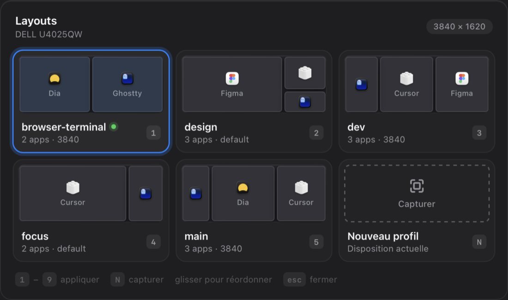
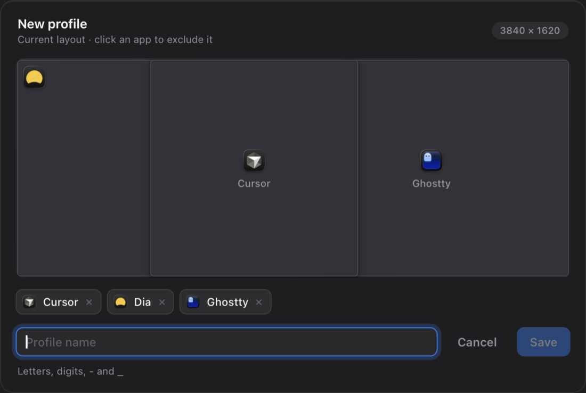

# Windr — your window layouts, one click away

Windr adds an icon to the macOS menu bar. It opens a panel listing your **layout profiles**: where Cursor goes, where the terminal goes, where Figma goes, and so on. Click a profile and every window snaps into place.



- **Apply** a profile with one click, or with keys `1` to `9`
- **Capture** your current window arrangement as a new profile
- **Edit** a profile: remove an app, rename it
- **Reorder** profiles with drag and drop
- **Per-screen variants**: one profile can hold one arrangement for your external display and another for your MacBook

Windr is a plugin ("Spoon") for [Hammerspoon](https://www.hammerspoon.org), a free and open-source macOS automation tool.

🇫🇷 [Version française](README.fr.md) · 📋 [Changelog](CHANGELOG.md)

> The interface follows your macOS language (English or French). See the `language` option to force one.

---

## Installation (5 minutes)

### 1. Install Hammerspoon

```sh
brew install --cask hammerspoon
```

If you don't use Homebrew, download it from [hammerspoon.org](https://www.hammerspoon.org).

Launch Hammerspoon, then:

- **Grant Accessibility access**: `System Settings → Privacy & Security → Accessibility` → turn on **Hammerspoon**. Without it, windows won't move.
- **Start at login**: click the Hammerspoon icon (the hammer) in the menu bar → `Preferences…` → check **Launch Hammerspoon at login**.

### 2. Install Windr

[**Download Windr.zip**](https://github.com/jcsuzanne/windr/raw/main/dist/Windr.zip), unzip it, then **double-click `Windr.spoon`**. Hammerspoon installs it into `~/.hammerspoon/Spoons/` for you.

If double-clicking does nothing, copy it manually:

```sh
mkdir -p ~/.hammerspoon/Spoons && cp -R Windr.spoon ~/.hammerspoon/Spoons/
```

### 3. Enable Windr

Open Hammerspoon's config file: hammer icon → `Open Config`, or open `~/.hammerspoon/init.lua` directly. Add:

```lua
hs.loadSpoon("Windr")
spoon.Windr:start()
```

Save, then hammer icon → **Reload Config**. A new icon (a rectangle split into panes) appears in the menu bar: that's Windr.

---

## Updating

Your profiles, their order and your options are **kept**: they live in `~/.hammerspoon/windr_layouts.json` and in your `init.lua`, outside the Spoon folder. An update only replaces `~/.hammerspoon/Spoons/Windr.spoon`.

**Option 1: one terminal command (recommended)**

```sh
cd "${TMPDIR:-/tmp}" && curl -fsSL -o Windr.zip https://github.com/jcsuzanne/windr/raw/main/dist/Windr.zip \
  && rm -rf windr-update && unzip -q Windr.zip -d windr-update \
  && rm -rf ~/.hammerspoon/Spoons/Windr.spoon && cp -R windr-update/Windr.spoon ~/.hammerspoon/Spoons/
```

Then hammer icon → **Reload Config**. If you installed the `hs` command (see below), `hs -c 'hs.reload()'` does the same.

**Option 2: by hand**

1. [Download Windr.zip](https://github.com/jcsuzanne/windr/raw/main/dist/Windr.zip) and unzip it.
2. Delete the old `~/.hammerspoon/Spoons/Windr.spoon` folder. In Finder: `⌘⇧G`, paste `~/.hammerspoon/Spoons`.
3. Double-click the new `Windr.spoon`, or copy it into that folder.
4. Hammer icon → **Reload Config**.

**Option 3: with git**, if you'd rather follow the repo

```sh
git clone https://github.com/jcsuzanne/windr.git ~/Code/windr
rm -rf ~/.hammerspoon/Spoons/Windr.spoon
ln -s ~/Code/windr/Windr.spoon ~/.hammerspoon/Spoons/Windr.spoon
```

After that, updating is just `git -C ~/Code/windr pull` followed by **Reload Config**.

**Which version do I have?** Hover the Windr icon in the menu bar, or hammer icon → `Console`, type `spoon.Windr.version` and press Enter. What changed in each version is in the [changelog](CHANGELOG.md).

---

## Getting started: create your first profile

1. Arrange your windows the way you like them (for example, editor on the left, browser on the right).
2. Click the Windr icon, or press `⌘⌥⌃Space`.
3. Click **Capture**, or press `N`.
4. A preview of your arrangement appears. **Click an app to exclude it** if it shouldn't be part of the profile.
5. Type a name (`dev`, `design`, `call`…) and press **Enter**.

That's it. Next time, open the panel and click `dev`: everything goes back into place.



> Finder and System Settings are never captured. Their windows are usually open by accident.

---

## Usage

| Action | How |
| --- | --- |
| Open / close the panel | Menu bar icon, or `⌘⌥⌃Space` |
| Apply a profile | Click its card, press `1`–`9`, or use arrow keys + `Enter` |
| New profile | **Capture** card, or `N` |
| Reorder | Drag and drop a card (the numbers follow) |
| Close | `Esc`, or click anywhere else |

Hover over a card and three buttons appear in its top-right corner:

- ✏️ **Edit**: remove or restore apps, rename the profile
- ⧉ **Replace**: overwrite the profile with your current window arrangement
- ✕ **Delete**: click a second time to confirm

The green dot marks the last profile you applied. A closed app is greyed out in the preview and is skipped until you open it.

### Per-screen variants

A profile is saved for the width of the screen you capture it on (for example `3840` for a wide 4K display). It is also used as the **default** arrangement on other screens. Capturing the same profile on your MacBook adds a variant for that screen. Each card shows which variant is in use under its name.

---

## Options

All options are optional:

```lua
hs.loadSpoon("Windr")
spoon.Windr:start({
  -- Shortcut to open the panel (false for none)
  hotkey = { { "cmd", "alt", "ctrl" }, "space" },

  -- ⌘⌥⌃1 … ⌘⌥⌃9 apply profiles directly, in panel order
  profileHotkeys = { "cmd", "alt", "ctrl" },

  -- Apps that should never be captured (bundle IDs)
  ignore = { "com.tinyspeck.slackmacgap" },

  -- Interface language: "auto" (follows macOS), "en" or "fr"
  language = "auto",
})
```

You can also define profiles in code. Positions are fractions of the screen, `{x, y, width, height}` between 0 and 1:

```lua
spoon.Windr:start({
  layouts = {
    dev = {
      default = {
        Cursor  = { 0,   0, 0.5, 1 },   -- left half
        Ghostty = { 0.5, 0, 0.5, 1 },   -- right half
      },
    },
  },
})
```

Profiles captured from the panel are saved in `~/.hammerspoon/windr_layouts.json`.

### Bonus: a `layout` command in the terminal

In `~/.hammerspoon/init.lua`:

```lua
require("hs.ipc")
hs.ipc.cliInstall("/opt/homebrew")   -- installs the `hs` command (Apple Silicon Mac with Homebrew)
```

In `~/.zshrc`:

```sh
layout() { hs -c "spoon.Windr:apply(\"$1\")"; }
```

Then `layout dev` applies the `dev` profile, and `hs -c 'spoon.Windr:save("dev")'` captures your current arrangement under that name.

---

## Troubleshooting

- **Windows don't move**: check Hammerspoon's Accessibility permission. If it's already on, turn it off and on again, then restart Hammerspoon.
- **The icon doesn't appear**: hammer icon → `Console` to see the error. Make sure `Windr.spoon` is in `~/.hammerspoon/Spoons/`.
- **An app isn't moved**: it has to be open. App names are the ones macOS displays (for example `Google Chrome`, not `chrome`).
- **Uninstall**: remove the two lines from `init.lua`, then delete `~/.hammerspoon/Spoons/Windr.spoon` and `~/.hammerspoon/windr_layouts.json`.

---

## License

[MIT](LICENSE)
